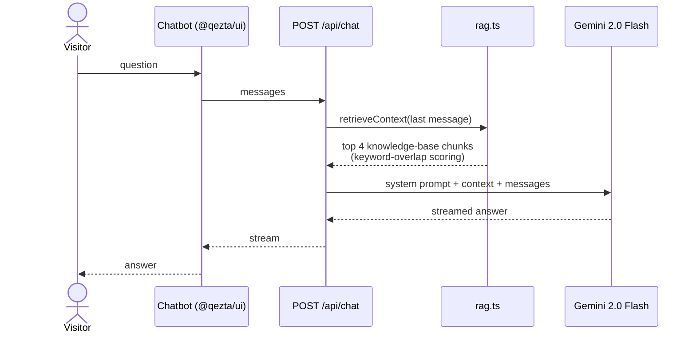

<div id="top">
    <div align="center">
        
        <h1 align='center'>divit</h1>
        <strong>divit.qezta.com: personal portfolio with Gemini-powered RAG chatbot</strong>
    </div>

</div>

---

<div align='center'>
    <a href="https://github.com/Qezta/divit/stargazers">
        
    </a>
    <a href="https://github.com/Qezta/divit/">
        
    </a>
    <a href="https://github.com/Qezta/divit/blob/main/LICENSE">
        
    </a>
    <a href="https://github.com/nixos/nixpkgs">
        
    </a>
    <a href="https://divit.qezta.com">
        
    </a>
    
</div>

---

<div align='center'>
    <a href="https://github.com/Qezta/divit/actions/workflows/flake-check.yml">
        
    </a>
    <a href="https://github.com/Qezta/divit/actions/workflows/gen-sitemap.yml">
        
    </a>
</div>

---

## Contents

- [Overview](#overview)
- [Stack](#stack)
- [How the chatbot works](#how-the-chatbot-works)
- [Development](#development)
- [Environment](#environment)
- [License](#license)

---

## Overview

Personal portfolio site for Divit Mittal, deployed at
[divit.qezta.com](https://divit.qezta.com). Includes a RAG-powered chatbot
("digital avatar") for visitors to ask about Divit's background, projects,
and skills.

## Stack

- **SvelteKit** with `@sveltejs/adapter-vercel`
- **Three.js** WebGL cursor
- **Google Gemini 2.0 Flash** via `@google/genai` for the chatbot
- Shared design system: [`@qezta/ui`](https://github.com/qezta/ui) (git dep, pinned to a tag)

## How the chatbot works



## Development

```sh
pnpm install
pnpm dev        # vite dev server
pnpm check      # svelte-check
pnpm lint       # prettier + eslint
pnpm build      # production build (Vercel output)
pnpm build:ipfs # static mirror in build/ipfs, with chat disabled
```

## Environment

For the chatbot to work locally, create `.env`:

```
GEMINI_API_KEY=...  # from aistudio.google.com
```

In Vercel, set `GEMINI_API_KEY` in the project's environment variables.

## License

MIT — see [LICENSE](./LICENSE).

<div align="right">

[![][back-to-top]](#top)

</div>

[back-to-top]: https://img.shields.io/badge/-BACK_TO_TOP-151515?style=flat-square&color=purple
